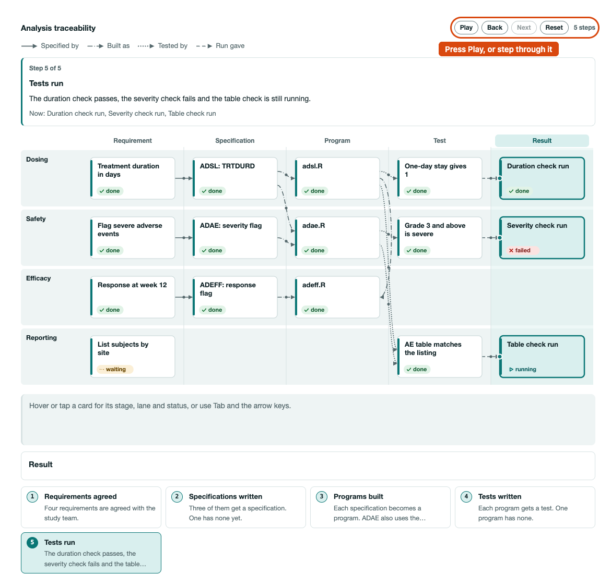

# stagemap

<!-- badges: start -->
[](https://github.com/insightsurge/stagemap/actions/workflows/r-cmd-check.yaml)
[](https://lifecycle.r-lib.org/articles/stages.html#experimental)
[](https://app.codecov.io/gh/insightsurge/stagemap)
<!-- badges: end -->

A missing arrow is easy to overlook in a flowchart, and a tracking table can fall behind the specification. `stagemap` keeps cards, links and stages in R tables, draws them as a map and checks them in code. The map shows in the R console viewer, in Quarto and R Markdown documents and in Shiny apps.



The map plays as a story: press Play, or step through it with Back and Next, and the cards change as each stage is reached. Two cards stand out: "List subjects by site" has no link, and the Efficacy program has no test. Several arrows cross from one lane to another.

## Installation

stagemap needs R 4.1.0 or later. Install the development version from GitHub.

```r
# install.packages("pak")
pak::pak("insightsurge/stagemap")
```

## A first map

Six small tables describe the map: the cards, the links between them, the kinds of link, the stages, the steps of the player and the changes each step makes to the cards.

```r
library(stagemap)

cards <- data.frame(
  id = c(
    "req_dur", "req_ae", "req_eff", "req_site",
    "spec_dur", "spec_ae", "spec_eff",
    "prog_adsl", "prog_adae", "prog_adeff",
    "test_dur", "test_ae", "test_tbl",
    "run_dur", "run_ae", "run_tbl"
  ),
  label = c(
    "Treatment duration in days", "Flag severe adverse events", "Response at week 12", "List subjects by site",
    "ADSL: TRTDURD", "ADAE: severity flag", "ADEFF: response flag",
    "adsl.R", "adae.R", "adeff.R",
    "One-day stay gives 1", "Grade 3 and above is severe", "AE table matches the listing",
    "Duration check run", "Severity check run", "Table check run"
  ),
  stage = rep(c("requirement", "specification", "program", "test", "result"), c(4, 3, 3, 3, 3)),
  lane = c(
    "Dosing", "Safety", "Efficacy", "Reporting",
    "Dosing", "Safety", "Efficacy",
    "Dosing", "Safety", "Efficacy",
    "Dosing", "Safety", "Reporting",
    "Dosing", "Safety", "Reporting"
  ),
  status = c("done", "done", "done", "waiting", rep("waiting", 12))
)
links <- data.frame(
  from = c(
    "req_dur", "req_ae", "req_eff",
    "spec_dur", "spec_ae", "spec_eff", "spec_dur", "prog_adsl",
    "prog_adsl", "prog_adae", "prog_adae", "prog_adsl",
    "test_dur", "test_ae", "test_tbl"
  ),
  to = c(
    "spec_dur", "spec_ae", "spec_eff",
    "prog_adsl", "prog_adae", "prog_adeff", "prog_adae", "prog_adeff",
    "test_dur", "test_ae", "test_tbl", "test_tbl",
    "run_dur", "run_ae", "run_tbl"
  ),
  kind = c(
    rep("specified", 3),
    rep("built", 5),
    rep("tested", 4),
    rep("result", 3)
  )
)
kinds <- data.frame(
  id = c("specified", "built", "tested", "result"),
  label = c("Specified by", "Built as", "Tested by", "Run gave"),
  line = c("solid", "dashdot", "dotted", "dashed")
)
stages <- data.frame(
  id = c("requirement", "specification", "program", "test", "result"),
  label = c("Requirement", "Specification", "Program", "Test", "Result")
)
steps <- data.frame(
  id = c("agreed", "specified", "built", "tested", "run"),
  label = c("Requirements agreed", "Specifications written", "Programs built", "Tests written", "Tests run"),
  stage = stages$id,
  text = c(
    "Four requirements are agreed with the study team.",
    "Three of them get a specification. One has none yet.",
    "Each specification becomes a program. ADAE also uses the duration rule, and ADEFF reads ADSL.",
    "Each program gets a test. One program has none.",
    "The duration check passes, the severity check fails and the table check is still running."
  )
)
changes <- data.frame(
  step = c(rep("specified", 3), rep("built", 3), rep("tested", 3), rep("run", 3)),
  card = c(
    "spec_dur", "spec_ae", "spec_eff", "prog_adsl", "prog_adae", "prog_adeff",
    "test_dur", "test_ae", "test_tbl", "run_dur", "run_ae", "run_tbl"
  ),
  status = c(rep("done", 9), "done", "failed", "running")
)
map <- stage_map(cards, stages, title = "Analysis traceability") |>
  add_links(links, kinds = kinds) |>
  add_steps(steps, changes = changes, intro = "Follow one analysis from requirement to result.")

map
```

## One step more

Ask the same `map` object which requirement has no specification, which program has no test, or what one requirement reaches downstream.

```r
sm_missing(map, "requirement", linked_to = "specification")
#>         id                 label       stage      lane
#> 1 req_site List subjects by site requirement Reporting

sm_missing(map, "program", linked_to = "test")
#>           id   label   stage     lane
#> 1 prog_adeff adeff.R program Efficacy

sm_trace(map, "req_ae")[, c("id", "stage", "direction", "distance")]
#>          id         stage  direction distance
#> 1    req_ae   requirement      start        0
#> 2   spec_ae specification downstream        1
#> 3 prog_adae       program downstream        2
#> 4   test_ae          test downstream        3
#> 5  test_tbl          test downstream        3
#> 6    run_ae        result downstream        4
#> 7   run_tbl        result downstream        4
```

## Why

A week before a review, a programmer is asked which study requirements have no test. When the links live in a slide and a spreadsheet, the answer means cross-checking by hand. With cards and links in R, the map and the checks read the same tables, so the answer is a function call and a highlighted card. The map and the checks help reviewers inspect links; qualification of the software stays with your own procedures.

## The studio

`stage_map_studio()` opens a Shiny app where you click a card, a stage, a lane or a link and change it in a form. The app keeps a journal with Undo, runs `sm_trace()`, `sm_orphans()` and `sm_missing()` on the map, shows what stops `stage_map()` and how to fix it, and writes the R code for every change. **Done** gives the map back to R.

```r
map <- stage_map_studio(map)
```

## Exports

| Job | Functions |
| --- | --- |
| Draw | `stage_map()`, `add_links()`, `add_zones()`, `add_steps()`, `add_variants()` (experimental) |
| Ask | `sm_trace()`, `sm_orphans()`, `sm_missing()` |
| Read back | `stage_map_tables()` (the tables a map holds), `stage_map_code()` (the R code that builds it) |
| Shiny | `stage_map_output()`, `render_stage_map()`, `stage_map_proxy()`, `stage_map_select()`, `stage_map_highlight()`, `stage_map_show()` (experimental), `stage_map_hide()` (experimental), `stage_map_enable()` (experimental), `stage_map_disable()` (experimental) |
| Studio | `stage_map_studio()` (experimental): change a map through forms in an app, ask it questions, check it, copy its R code, and take the map back to R |

Read the [Get started](https://insightsurge.github.io/stagemap/articles/stagemap.html) article (`vignette("stagemap")`) for zones, steps and Shiny, or run the demo app with `shiny::runApp(system.file("examples", "shiny-demo", package = "stagemap"))`.

## Status

Early development; `stagemap` is the working name, and the package is not on CRAN. Experimental: `add_variants()`, the `"levels"` and `"dates"` layouts with `target` and `variant`, `stage_map_show()`, `stage_map_hide()`, `stage_map_enable()`, `stage_map_disable()` and the `input$<id>_hovered` Shiny input. The rest is meant to stay, but names and arguments can still change before the first release. Writing a static image is not built yet.

The coverage badge counts the R code the tests run. The JavaScript engine that draws the maps in the browser is tested there and is not part of that figure.

## Contributing

Open an issue with one of the issue forms before starting work. The contributing guide is in
[`.github/CONTRIBUTING.md`](https://github.com/insightsurge/stagemap/blob/main/.github/CONTRIBUTING.md).

## Licence

MIT © Harsh Verma.
